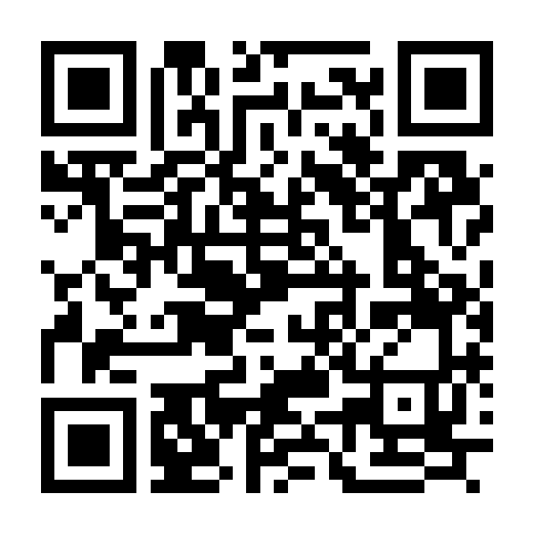
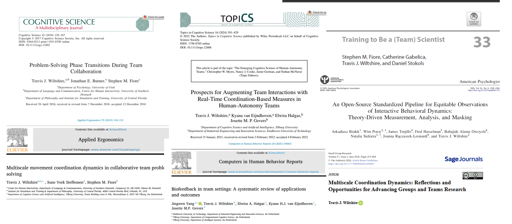
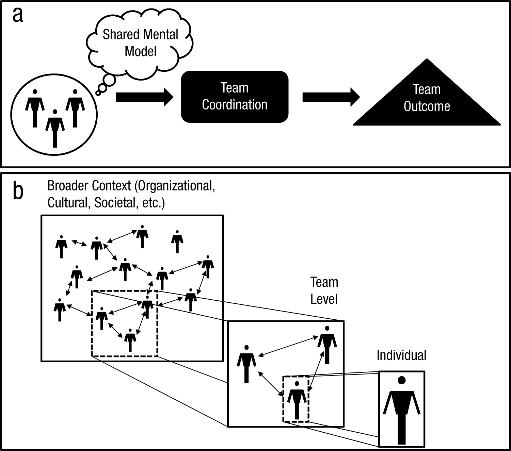
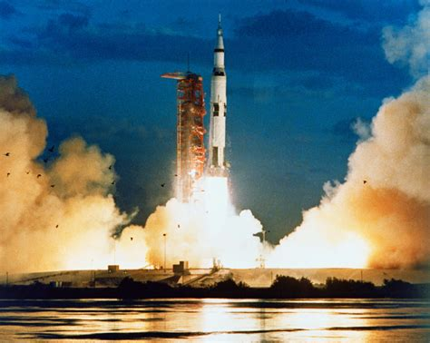
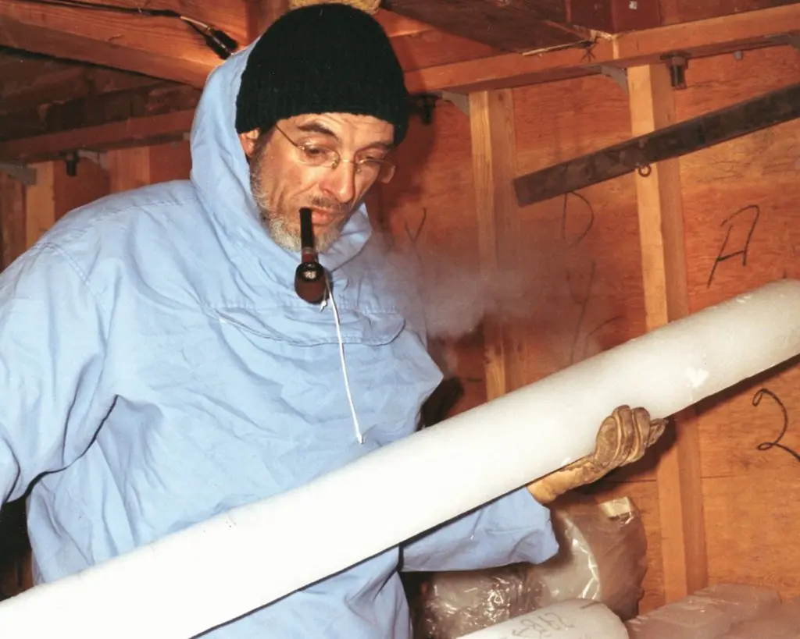
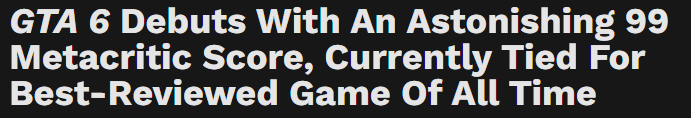
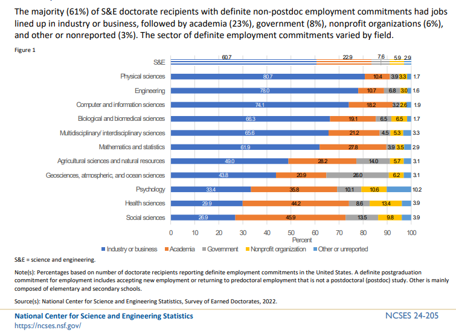
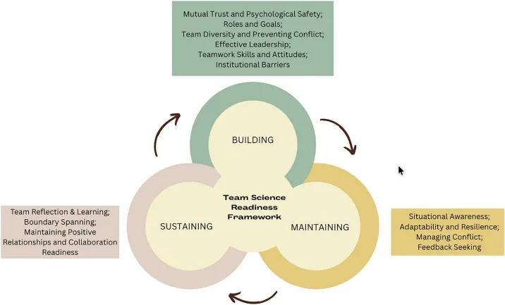

```{=html}
<!-- Speaker notes (press S) hold facilitation tips and sources to verify.
     Rule: no ### headings inside ::: activity boxes (creates hidden vertical slides);
     use [Label]{.activity-title}. Dividers are ## slides, not # (avoids vertical stacks). -->
```

## Slides and materials {.smaller}

:::: {.columns}
::: {.column width="65%"}
- Slides (live): <https://travisjwiltshire.github.io/teamscienceworkshop/>
- Repository with handouts and source:
  <https://github.com/travisjwiltshire/teamscienceworkshop>
:::

::: {.column width="35%"}
{fig-align="center" width="320"}
:::
::::

## About Me (Travis J. Wiltshire) {.smaller .tight}

- Professional
  - Associate Professor at Tilburg University
  - Collective cognition and complex systems
  - Team and interpersonal interaction dynamics
  - PhD Supervisor was Steve Fiore (Science of Team Science/ Team
    Cognition)
- Values
  - Open Science
  - Collaboration and Team Science
  - Mentorship

## Expertise Examples



## Learning objectives

By the end of this workshop you will be able to:

1.  **Explain** why teamwork matters for research and careers
2.  **Distinguish** taskwork from teamwork
3.  **Identify** conflict types and discuss how your team handles them
4.  **Practice** transferable skills, especially team reflexivity
5.  **Document** your teamwork as evidence for CVs and applications

::: notes
Each objective maps to an activity: 1 to the talk and Activity 1; 2 to
Activity 1 and the taskwork/teamwork slides; 3 to Activity 2 and the
team charter; 4 to the demo, Activity 4, Escape Room and lunch debrief;
5 to Activity 3 and the debrief evidence log.
:::

## Today, 09:00-11:00 {.smaller .scrollable}

| Time | Block | Mode |
|------------------------|------------------------|------------------------|
| 09:00 | Welcome, introductions, objectives | Talk |
| 09:08 | **Activity 1** · Your research orientation (ROS) | Individual + pairs |
| 09:26 | Why teamwork matters in academia: the evidence | Talk |
| 09:38 | Why employers outside academia care too | Talk + chat |
| 09:44 | What teamwork actually is: taskwork, teamwork, competencies | Talk |
| 09:52 | **Activity 2** · Trust and conflict scenarios | Chat |
| 10:11 | Transferable competencies, and how to develop teamwork | Talk + mini-demo |
| 10:23 | Evidence of teamwork, then **Activity 3** · Audit your evidence | Talk + individual + pairs |
| 10:38 | Team reflexivity, then **Activity 4** · Team charter and Escape Room briefing | Escape room teams |
| 10:55 | Take home and close |  |

::: notes
120 min, no formal break; a 5 min stretch can go after Activity 2. Teams
for Activity 4 are the Escape Room teams: 23 people, e.g. five teams (3
of 5, 2 of 4), adjusted to room capacity. Approximate budget (min):
intro 8, Activity 1 18 (including the orientation slide), evidence talk
12, employers 6, taskwork/teamwork 8, Activity 2 19 (4 talk + 15
activity), competencies and development 12, evidence and Activity 3 15
(5 talk + 10 activity), reflexivity and Activity 4 17 (3 + 10 + 4
briefing), close 5. Timings are tight: if running late, shorten Activity
2 or the competencies block.
:::

## Activity 1: Research Orientation {.navy background-color="#1B3668"}

## Looking back at Days 1 and 2 {.smaller}

::: activity
[Individual, pairs, plenary · 15 min]{.activity-title}

On Day 1 you worked on **communication**; on Day 2 on
**interdisciplinarity**, today is *teamwork*.

1.  **Alone (5 min):** complete the **Research Orientation Scale**
    (handout) and score your **U**ni-, **M**ulti- and
    **I**nterdisciplinary orientation
2.  **Pairs (6 min):** compare scores, then discuss how it has felt
    working in a group in the past. Can you recall one moment that
    worked well, one that was hard: was it about the **science or
    task**, or about **how the group or team worked**?
3.  **Plenary (4 min):** share themes
:::

::: notes
Handout: "SciTS Workshop Measures (ROS and SAS)". Scores are for
self-reflection, not diagnosis. The Scholarly Activities Scale (SAS) can
be a take-home.
:::

## What your orientation means for teamwork {.smaller}

| Orientation | Tends to mean | Teamwork implication |
|------------------------|------------------------|------------------------|
| **Unidisciplinary** | One discipline, one lens | Comfortable, but jargon can be invisible to others |
| **Multidisciplinary** | Parallel work, results placed side by side | Efficient, but integration is left to chance |
| **Interdisciplinary** | Integrating concepts and methods across fields | Powerful, but needs more communication and trust |

No orientation is "best": teams need a mix, and you can **choose** to
span boundaries yourself.

::: notes
Ask: did your score match how Day 2 felt? Did anyone score high on one
type and find the group hard? Link to the evidence slide on moderate
disciplinary diversity. Transdisciplinary (including non-academic
stakeholders) is the further step relevant to DARA.
:::

## Why teamwork? {.navy background-color="#1B3668"}

## What is a team? 

::::: columns
::: {.column width="50%"}
- When two or more people work together for a period of time toward some shared goal of commonly valued function 

::: {.small}
Gorman, J. C. (2014). Team coordination and dynamics: two central issues. *Current Directions in Psychological Science, 23*(5), 355-360.
:::
:::

::: {.column width="50%"}
{fig-alt="Figure from Gorman (2014) on team coordination and dynamics" fig-align="center"}
:::
:::::

::: notes
You can have multi-team systems: teams nested within or linked to other teams working toward larger shared goals.
:::


## Why teamwork?

It's simple. When people work together, they can accomplish more than
they would working alone.

::::: columns
::: {.column width="50%"}
{fig-alt="Apollo mission"
height="240"}
:::

::: {.column width="50%"}
{fig-alt="Willi Dansgaard"
height="240"}
:::
:::::

{fig-alt="Headline: GTA 6 debuts with an astonishing 99 Metacritic score" fig-align="center" width="60%"}

::: notes
Two examples of scientific teamwork, plus one from outside science.


Apollo missions: landing humans on the Moon was only possible because of
a very large, coordinated effort. Commonly cited figures are around
400,000 people across NASA, universities and industry contractors,
spanning engineering, geology, medicine, software, manufacturing and
mission operations. No individual could hold all the needed expertise;
success depended on integrating specialties and on clear roles,
communication and shared goals.

Willi Dansgaard: Danish geophysicist and pioneer of ice core
paleoclimatology (oxygen isotopes in Greenland ice as a record of past
temperatures). Ice coring needed physicists, chemists, glaciologists,
drillers and logistics teams, and long-running international projects
(e.g., Camp Century, Dye 3, GRIP). The Dansgaard-Oeschger events are
named for him and the Swiss physicist Hans Oeschgers.

GTA 6 headline: a deliberately non-scientific example to show that the
same logic holds anywhere. Blockbuster games are reportedly built by
very large, multi-year teams of designers, artists, writers, engineers,
audio and QA specialists, so a top-rated product is a team outcome, not
the work of one genius. 

what did these teams need beyond individual talent?
:::

## Your PhD may feel individual, but your science will likely not be. {.smaller}

- DARA's objective "To intertwine PhD fellows from highly diverse
  backgrounds and thereby allow for students in DARA to have an
  exceptionally wide scientific horizon."
- Many funders, including European Research Council, Danish Independent
  Research Fund, increasingly ask for/fund collaboration,
  internationalization, networks, and shared outputs
- Scientific and societal problems are not "disciplinary"
- Collaboration across disciplines, institutions, and countries is now
  normal in research
- The **Science of Team Science (SciTS)** is the field that studies what
  makes such teams work.

## What the evidence says (1): collaboration pays off {.smaller}

Hall et al. (2018) reviewed the empirical literature on science teams.

- **Boundary-spanning** collaborations (international, multi-university,
  inter/cross/multi-disciplinary) are associated with greater productivity and
  scientific impact than less distributed teams or solo work
- Team size is consistently and positively associated with research
  impact
- Moderate cultural diversity tends to give the highest-impact
  publications (a bell-shaped relationship)
- Mixed-gender teams tend to receive more citations and have higher
  grant funding chances

<p class="small">

Hall, K. L., Vogel, A. L., Huang, G. C., Serrano, K. J., Rice, E. L.,
Tsakraklides, S. P., & Fiore, S. M. (2018). The science of team science:
A review of the empirical evidence and research gaps on collaboration in
science. *American Psychologist, 73*(4), 532–548.

</p>

::: notes
(see Wuchty et al. 2007, Jones et al. 2008, in Hall et al. 2018)
:::

## What the evidence says (2): it is not automatic {.smaller}

- Most of these findings are **correlational**: strong teams may also
  attract stronger people and more resources
- More investigators and more disciplines bring more **complexity**:
  communication, coordination, conflict
- Teams with a history of collaboration, and good processes, are better
  placed to turn diversity into impact
- The review's conclusion is that team science success depends on
  **strategies for teamwork**, which can be learned

**Collaboration helps when the team works well. That is the part you can
develop.**

::: notes
:::

## Teamwork shows up in how academic careers are judged {.smaller}

| In academia | What teamwork looks like |
|------------------------------------|------------------------------------|
| Papers | Co-authorship, agree on authorship and roles early |
| Grants | Consortia, networks, interdisciplinary applications |
| Lab and supervision | Working with supervisors, peers, technicians, students |
| Review and service | Peer review, committees, organizing events |
| Reputation | Collaborators who want to work with you again |

Contributions are increasingly **made visible**, for example with
[CRediT author roles](https://credit.niso.org/) and [narrative
CVs](https://sfdora.org/?s=narrative+CV).

## Beyond academia, employers ask for the same skills {.smaller}

::::: columns
::: {.column width="55%"}
- Teamwork and collaboration are among the most requested skills in
  graduate and PhD-level recruitment
- Many PhD graduates work outside academia, in industry, healthcare,
  policy, start-ups
- Multi-disciplinary teams are the default in industry R&D
:::

::: {.column width="45%"}
**But there is a perception gap**

About **2/3** of graduates say they can work in a team, vs about **1/3**
of managers who agree

<p class="small">

Hart Research Associates (2015), cited in Fiore, Gabelica, Wiltshire &
Stokols (2019)

</p>
:::
:::::

## Whichever path you choose, teamwork continues to matter {.tight .bigfig}





- The competence **transfers**; the context and vocabulary change

::: notes
Quick poll: raise of hands for which pathway they are considering. Leave
it open, many may be undecided.
:::

## Two things every team must do

::::: columns
::: {.column width="50%"}
### Taskwork

What the team is **doing**: methods, data, analysis, writing
:::

::: {.column width="50%"}
### Teamwork

How members **interact** to get it done: communicating, coordinating,
trusting, handling disagreement
:::
:::::

Learning outcomes for both can be framed as **K**nowledge, **S**kills
and **A**ttitudes.

::: notes
:::

## Which competencies do you need? It depends.

::: tbl-grid
|                   | Task-specific   | Task-generic      |
|-------------------|-----------------|-------------------|
| **Team-specific** | Context-driven  | Team-contingent   |
| **Team-generic**  | Task-contingent | **Transportable** |
:::

**Transportable** competencies travel with you from team to team, and
from academia to industry. They are today's focus.

::: notes
Four types from Cannon-Bowers et al. (1995) / Fiore (2008). Paired
training: focused seminars (context-driven), Toolbox cross-disciplinary
communication (team-contingent), knowledge building (task-contingent),
team reflexivity (transportable).
:::

## Components of *Team* work in Science (ABCs)


::: notes
super tuning is Tailoring message for the receiver Drawing on
understanding of audience level and form of knowledge Construct and
convey message in appropriate ways
:::

## Activity 2: Affect: Trust & Conflict {.navy background-color="#1B3668"}

## Trust in teams


## Trust and conflict: a task side and a team side

::::: columns
::: {.column width="50%"}
### Trust

Willingness to be vulnerable to others

- **Task**: confidence in others' expertise
- **Team**: confidence in interpersonal goodwill
:::

::: {.column width="50%"}
### Conflict

- **Task**: disagreement about the work
- **Team**: interpersonal friction
:::
:::::

::: notes
Mayer et al. 1995; Fiore, Carter & Asencio 2015; De Dreu & Weingart;
Behfar et al. 2011 (from Fiore's Week 3 deck).
:::

## Four types of conflict {.smaller}

| Type | About | Example |
|------------------------|------------------------|------------------------|
| **Task** | The content of the work | Two fields interpret the same result differently |
| **Relationship** | Personal friction | Tension after blunt feedback in a meeting |
| **Contribution** | Who does how much, who gets credit | Disagreement over author order |
| **Logistical** | Time, tools, coordination | A shared dataset arrives late |

Conflict is not always harmful: **how a team handles it** matters more
than whether it occurs.

<p class="small">

Behfar, K. J., Mannix, E. A., Peterson, R. S., & Trochim, W. M. (2011).
Conflict in small groups: The meaning and consequences of process
conflict. *Small Group Research, 42*(2), 127–176.
<https://doi.org/10.1177/1046496410389194>

</p>

::: notes
:::

## Your team for the Escape room today


## Conflict scenarios {#conflict-scenarios}

::: activity
[15 min · your Escape Room team]{.activity-title}

Each team gets **one scenario** (handout):

- [**A**](#scenario-a) Author order is disputed on a shared paper
- [**B**](#scenario-b) Two disciplines read the same result differently
- [**C**](#scenario-c) A colleague misses a deadline and blocks everyone
  else
- [**D**](#scenario-d) Someone is hurt by blunt feedback in a meeting
- [**E**](#scenario-e) An industry partner wants results before the
  science is ready
:::

## Conflict scenarios: your task

::: activity
[15 min · your Escape Room team]{.activity-title}

1.  **Diagnose (3 min):** which conflict type(s)? Is the damaged trust
    about **expertise** or **goodwill**?
2.  **Respond (7 min):** what would you say or do first? What could have
    been agreed **in advance**?
3.  **Write (3 min):** one sentence for your **"How we handle
    disagreement"** charter line
4.  **Report (2 min):** one takeaway per team
:::

::: notes
Teams are the Escape Room teams, so the sentence written in step 3 goes
straight into the team charter in Activity 4 (photograph or keep it).
Five scenarios (E is industry-oriented); teams share if there are more
than five. Print handouts/conflict-scenarios.pdf (one per team, or one
per person). Click A-E on the activity slide to show a scenario on
screen (appendix slides after "Questions?"); the back link returns to
the activity. Scenarios are deliberately realistic for PhD teams (CRediT
and authorship conversations link to the earlier slide). The optional
trust questionnaire (reliance vs disclosure, Gillespie 2003) can be a
handout. If running late, drop step 4 and collect sentences at the
charter.
:::

## Three transferable competencies {.tight}

:::::: columns
::: {.column width="33%"}
### Psychological safety

*Attitude.* Can you say "I don't understand" or "I made a mistake" here?
:::

::: {.column width="33%"}
### Active listening

*Behavior.* Paraphrase, clarify, check jargon.
:::

::: {.column width="33%"}
### Shared mental models

*Cognition.* Do we understand this similarly? And who knows what? (transactive memory)
:::
::::::

::: activity
[60-second demo · pairs]{.activity-title} A explains their PhD topic. B
paraphrases it back. Did B get it right? Swap.
:::

::: notes
Fiore LEAP deck slides 22-24. Add an Edmondson citation for
psychological safety if desired.
:::

## How do you actually develop teamwork? {.smaller}

1.  **Practice it deliberately**: treat every group as practice, not a
    distraction from the real work
2.  **Reflect regularly** (team reflexivity): a short pause to ask "what
    are we doing, how, and should we change it?"
3.  **Seek feedback**: ask collaborators what you do well and what to
    change
4.  **Learn the language**: team science training, workshops, mentoring,
    SciTS resources (e.g. the Team Science Toolkit)
5.  **Take roles that stretch you**: coordinating, organizing,
    mediating, mentoring

Effective training features include small groups, regular feedback, and
real problems (Fiore et al., 2019).

::: notes
Training features are in Table 33.7 of the 2019 chapter. Team
reflexivity: Gabelica et al. (2014).
:::

## Where evidence of teamwork comes from {.smaller}

| Type | Examples |
|------------------------------------|------------------------------------|
| **Outputs** | Co-authored papers shared datasets, software, posters, history of contributions to open science or github/codeberg repositories |
| **Roles** | Project coordinator, reading-group organizer, committee, buddy or mentor, CRediT roles listed in outputs |
| **Feedback** | Testimonials from collaborators, supervisor statements, peer-review comments |
| **Reflection** | Brief [blog](https://babieslearninglanguage.blogspot.com/), [social media](https://bsky.app/profile/mcxfrank.bsky.social/post/3mzxtjeshsy2i), or personal journal entries of what you tried and learned |
| **Training** | Workshops attended, team-science, or leadership courses |

**Start collecting now and make a habit of it.** Much harder to
reconstruct many years at once.

::: notes
Suggest a simple habit: a one-page "collaboration log" updated monthly.
Mention translating for audiences: "managed co-author disagreement"
(academia) vs "aligned stakeholders on a deliverable" (industry).
:::

## CRediT Roles

<iframe src="files/credit-roles.pdf#view=FitH" width="100%" height="480" style="border:none;">

</iframe>

<p class="small" style="margin-top:0;">

Hosseini et al. (2026), Zenodo. https://zenodo.org/records/18421449 (CC
BY 4.0)

</p>

## Safe Labs Handbook

<iframe src="https://safelabs.info/handbook/" width="100%" height="500" style="border:none;" loading="lazy">

</iframe>

<p class="small" style="margin-top:0;">

<https://safelabs.info/handbook/> (open in a new tab)

</p>

::: notes
what if you don't have a lab? Or if you collaborate widely across labs/disciplines? How can you use this? Adapt to a person perhaps, Makes expectations for collaboration explicit 
:::

## Repository Commit History {.scrollable}

{width="100%"}
[Link](https://github.com/WimPouw/TilburgMultiscaleSummerschool2026/graphs/contributors?from=5%2F11%2F2026&to=8%2F23%2F2026)

## Activity 3: Evidence of teamwork {.navy background-color="#1B3668"}

## Audit your teamwork evidence {.smaller}

::: activity
[Individual (5 min), then pairs (5 min) · 10 min]{.activity-title}

Skills claimed are not skills shown. Using the evidence types we just
covered:

1.  **Alone:** write down what you **already have** for each evidence
    type: outputs, roles, feedback, reflection, training
2.  **Alone:** pick **one gap** and one action to address it in your
    first year
3.  **Pairs:** pick one item; your partner asks, "what would convince a
    skeptical person you have this skill?"
:::

::: notes
Keep it light: the aim is to start a habit, not to produce a finished
CV.
:::

## Team reflexivity: a transportable teamwork skill {.smaller}

After a team performance episode, reflexivity follows three steps:

1.  **Review** how the team performed <br>["How did you ask for
    information? How did you pass on information? How was the team
    organized?"]{.small}
2.  **Think about improvements** in the processes and methods used
    <br>["Are there alternatives to your chosen task performance
    procedures, and if so, what are they?"]{.small}
3.  **Create suggestions** for future work, so the next time, processes
    and outcomes improve

<p class="small">

Based on Gurtner et al. (2007, p. 132), as described in Fiore, Gabelica,
Wiltshire & Stokols (2019); Gabelica et al. (2014)

</p>

::: notes
What even is a team performance episode in science? When should you engage in reflexivity? 
:::

## Activity 4: Team Charter {.navy background-color="#1B3668"}

## Navigating the teamwork component with a Team Charter {.smaller}

1.  **Expertise map** (roles): strengths and weaknesses, preferred work
    styles, availability and contact information
2.  **How we communicate** (coordination): timing and scheduling, how we
    meet, backup and feedback
3.  **How we disagree** (goal-setting and problem-solving): majority
    rules or consensus?
4.  **How we reflect** (performance and rewards): how we handle
    performance problems and give positive feedback, how we prevent
    dysfunctional conflict

<p class="small">

Mathieu, J. E., & Rapp, T. L. (2009). Laying the foundation for
successful team performance trajectories: The roles of team charters and
performance strategies. Journal of Applied Psychology, 94(1), 90.

</p>

::: notes
When should you build a team charter? When starting a new position? Hiring someone? Working on a grant together? Asked to collab and help? As a lab?
:::

## Your team for the Escape room today


## Build your team charter {.tight}

::: activity
[10 min · your Escape Room team]{.activity-title}

Agree a few lines on each:

1.  **Expertise map**: what each person brings and wants to learn
2.  **How we communicate**: how we make sure everyone is heard
3.  **How we handle disagreement**: what we do when stuck (use your
    Activity 2 sentence)
4.  **How we reflect**: when we pause to review, improve, and plan
:::

::: notes
Teams stay together for the Escape Room and the lunch debrief. Ask each
team to bring it to the debrief.
:::

## Escape Room: what to try, what to notice {.tight}

::::: columns
::: {.column width="50%"}
### Try

- A 60-second **expertise round** before touching a puzzle
- Name a **time keeper** and an **information keeper**; no single boss
- Pause once, 30 seconds: "how are we working?"
- Speak up with half-formed ideas
:::

::: {.column width="50%"}
### Notice

- Did everyone get heard?
- Did ideas get **combined**, or only passed on?
- Who did you hand things to, and why?
- Did your strategy change after a failure?
:::
:::::

**Afterwards: note one concrete example of your own contribution for
your evidence log.**

## Debrief at lunch: a team reflexivity session {.smaller .tight}

:::::: columns
::: {.column width="33%"}
### 1 · Review

- How did we ask for and pass on information?
- How were we organized? Who did what?
- Was any moment a task, relationship, contribution or logistical issue?
- Which part of our charter did we use?
:::

::: {.column width="33%"}
### 2 · Improve

- What alternatives to our approach could we have tried?
- What would we change in how we shared information, divided work or
  handled disagreement?
:::

::: {.column width="33%"}
### 3 · Plan

- What will we do differently **next time**, in the Escape Room or in
  our PhD teams?
- **One** concrete suggestion per team, shared in plenary
:::
::::::

**Then:** add one line to your evidence log: what you did in the Escape
Room, and what you would do differently.

::: notes
Run at the lunch venue, 20-30 min, in the same teams (about 8 min per
step, then plenary). Follows the three reflexivity steps on the earlier
slide, so the group experiences the method rather than just hearing
about it. Return to the Activity 1 flipchart themes if you have a photo.
:::

## Life Cycle of Scientific Teamwork {.lifecycle}

{.r-stretch fig-align="center"}

<p class="tiny">

Kilcullen, M. P., Bukhari, I., Terkowitz, M., Stevens, S., Lacanienta,
C., & Rosen, M. (2026). The Team Science Readiness Framework for
scientific research collaboration. Frontiers in Psychology, 17, 1792280.

</p>

::: notes
At this stage, we are thinking more about forming, but many teams can go
on to form persistent cores that continue to collaborate across their
careers. It can be important to think of the life cycle of the team and
whether it has this elements for building, maintaining, and sustaining
(or even amicabling brining a project/team to a close).
:::

## Team Science - Take homes {.smaller .tight}

- Team science and collaboration is linked with greater research impact, but only when it
  **works**: that part is learnable (transportable ABC's)
- Employers inside and outside academia increasingly want teamwork, and want
  **evidence** of it
- Practice **deliberately**, **reflect** (review, improve, plan) after
  each team episode, **collect** evidence as you go
- You are 23 scientists from many disciplines: grow together! 

<p class="small">

Hall, K. L., Vogel, A. L., Huang, G. C., Serrano, K. J., Rice, E. L.,
Tsakraklides, S. P., & Fiore, S. M. (2018). The science of team science.
*American Psychologist, 73*(4), 532-548.<br> Fiore, S. M., Gabelica, C.,
Wiltshire, T. J., & Stokols, D. (2019). Training to be a (team)
scientist. In *Strategies for Team Science Success* (pp. 421-441).
Springer.

</p>

## Questions?

Feel free to stay in touch!


[t.j.wiltshire\@tilburguniversity.edu](mailto:t.j.wiltshire@tilburguniversity.edu)


[\@tjwiltshire.bsky.social](https://bsky.app/profile/tjwiltshire.bsky.social)

Ackwowledgements: Steve Fiore (for inspiration/materials), James and Zac
from DARA for invitation/organization.

## References {.smaller .scrollable}

::: {.small .refs}
Association of American Colleges and Universities. (2007). *College
learning for the new global century*.

Behfar, K. J., Mannix, E. A., Peterson, R. S., & Trochim, W. M. (2011).
Conflict in small groups: The meaning and consequences of process
conflict. *Small Group Research, 42*(2), 127–176.
https://doi.org/10.1177/1046496410389194

Cannon-Bowers, J. A., Tannenbaum, S. I., Salas, E., & Volpe, C. E.
(1995). Defining team competencies and establishing team training
requirements. In R. Guzzo & E. Salas (Eds.), *Team effectiveness and
decision making in organizations* (pp. 333–380). Jossey-Bass.

De Dreu, C. K. W., & Weingart, L. R. (2003). Task versus relationship
conflict, team performance, and team member satisfaction: A
meta-analysis. *Journal of Applied Psychology, 88*(4), 741–749.

Fiore, S. M., Carter, D. R., & Asencio, R. (2015). Conflict, trust, and
cohesion: Examining affective and attitudinal factors in science teams.
In E. Salas, W. B. Vessey, & A. X. Estrada (Eds.), *Team cohesion:
Advances in psychological theory, methods and practice* (pp. 271–301).
Emerald Group Publishing.

Fiore, S. M., Gabelica, C., Wiltshire, T. J., & Stokols, D. (2019).
Training to be a (team) scientist. In K. L. Hall, A. L. Vogel, & R. T.
Croyle (Eds.), *Strategies for team science success* (pp. 421–441).
Springer.

Gabelica, C., Van Den Bossche, P., De Maeyer, S., Segers, M., &
Gijselaers, W. (2014). The effect of team feedback and guided
reflexivity on team performance change. *Learning and Instruction, 34*,
86–96.

Gorman, J. C. (2014). Team coordination and dynamics: two central issues.
*Current Directions in Psychological Science, 23*(5), 355-360.

Gurtner, A., Tschan, F., Semmer, N. K., & Nägele, C. (2007). Getting
groups to develop good strategies: Effects of reflexivity interventions
on team process, team performance, and shared mental models.
*Organizational Behavior and Human Decision Processes, 102*(2), 127–142.

Hall, K. L., Vogel, A. L., Huang, G. C., Serrano, K. J., Rice, E. L.,
Tsakraklides, S. P., & Fiore, S. M. (2018). The science of team science:
A review of the empirical evidence and research gaps on collaboration in
science. *American Psychologist, 73*(4), 532–548.

Hart Research Associates. (2015). *Falling short? College learning and
career success*. Association of American Colleges and Universities.

HHosseini, M., Kerridge, S., Allen, L., Kiermer, V., & Holmes, K.
(2026). CRediT Roles and Example Research Tasks That Could be Attributed
to Them. Zenodo. https://zenodo.org/records/18421449

Jones, B. F., Wuchty, S., & Uzzi, B. (2008). Multi-university research
teams: Shifting impact, geography, and stratification in science.
*Science, 322*(5905), 1259–1262. https://doi.org/10.1126/science.1158357

Kilcullen, M. P., Bukhari, I., Terkowitz, M., Stevens, S., Lacanienta,
C., & Rosen, M. (2026). The Team Science Readiness Framework for
scientific research collaboration. *Frontiers in Psychology, 17*,
Article 1792280.

Wuchty, S., Jones, B. F., & Uzzi, B. (2007). The increasing dominance of
teams in production of knowledge. *Science, 316*(5827), 1036–1039.
https://doi.org/10.1126/science.1136099

**Slides used as inspiration**

Fiore, S. M. (2018, January 29). *Understanding conflict and trust in
interdisciplinary research* \[Workshop presentation\]. Collaboration
Incubator Workshop, College of Graduate Studies, University of Central
Florida.

Fiore, S. M. (2023, October 8). *Science of Team Science in support of
NSF Science and Technology Centers* \[Virtual presentation\]. Learning
the Earth with Artificial Intelligence and Physics (LEAP) NSF Science
and Technology Center, Columbia University.
:::

## How to cite and reuse this talk {.smaller}

Wiltshire, T. J. (2026). *Team Science: Why teamwork matters in academia
and beyond* \[Workshop slides\]. DARA Induction 2026, Teamwork workshop,
19 November 2026. https://github.com/travisjwiltshire/teamscienceworkshop

- Live slides: <https://travisjwiltshire.github.io/teamscienceworkshop/>
- Please attribute the author when reusing or adapting these slides, and
  link back to the source above
- Third-party figures and quoted material (e.g., CRediT roles, the Team
  Science Readiness Framework) remain under their original licences and
  credits
- Questions or corrections are welcome:
  [t.j.wiltshire\@tilburguniversity.edu](mailto:t.j.wiltshire@tilburguniversity.edu)

**Generative AI statement:** Posit Assistant (Posit PBC), running Claude
Sonnet 5.5, was used in RStudio to help format the Quarto (.qmd) source
and slide styling. The author is responsible for all content.

```{=html}
<!-- Appendix: scenario slides for Activity 2, placed after the last slide and
     reached by clicking A-E on the "Conflict scenarios" slide (reveal.js removes
     data-visibility="hidden" slides, so they cannot be hidden that way).
     Keep the text in sync with handouts/conflict-scenarios.qmd. -->
```

## A. Author order {#scenario-a .smaller}

Five people from three institutions are finishing a paper. Sam wrote
most of the text and assumed first authorship. Alex did the analysis and
now says it was the core contribution and asks to share first
authorship. Authorship was never discussed at the start, and the
submission deadline is in two days.

<p class="small">

[Back to the activity](#conflict-scenarios)

</p>

## B. Same result, different readings {#scenario-b .smaller}

A computer scientist and a psychologist in an interdisciplinary team
find that their model improves accuracy by three percentage points. The
computer scientist calls this a strong result. The psychologist says the
measure is not valid and the difference is trivial and possibly due to
sampling error alone. Meetings keep circling, and each feels the other
does not understand their field.

<p class="small">

[Back to the activity](#conflict-scenarios)

</p>

## C. The missing dataset {#scenario-c .smaller}

Four team members are waiting for Pat's cleaned dataset to finish a
conference abstract. Pat promised it by Friday. Nothing arrives and Pat
has not replied. Two colleagues begin complaining about Pat in a private
chat. Pat is in a different time zone and is also overloaded with
teaching.

<p class="small">

[Back to the activity](#conflict-scenarios)

</p>

## D. Blunt feedback {#scenario-d .smaller}

In the weekly meeting a senior team member says to a first-year PhD
fellow, in front of everyone: "This analysis does not make sense. Have
you even inspected your data at all? Did you even check any assumptions
of this analysis?" The fellow goes quiet and withdraws, and over the
following weeks stops sharing drafts. Others notice, but nobody says
anything.

<p class="small">

[Back to the activity](#conflict-scenarios)

</p>

## E. The industry deadline {#scenario-e .smaller}

A university team is building a predictive model with an industry
partner. The partner's manager wants a dashboard for a board meeting in
ten days and asks to report the model accuracy now. The PhD researchers
know the model has not been validated on some new data and want another
month. The partner also wants to keep the data and code confidential,
while the researchers are committed to open science and also need to
publish. Team members split between "deliver what the client needs" and
"protect scientific integrity", and no one is sure how to proceed.

<p class="small">

[Back to the activity](#conflict-scenarios)

</p>
